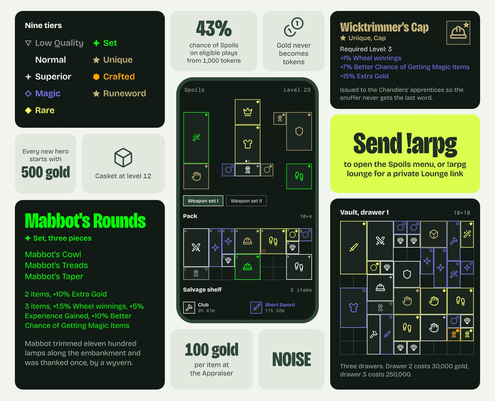
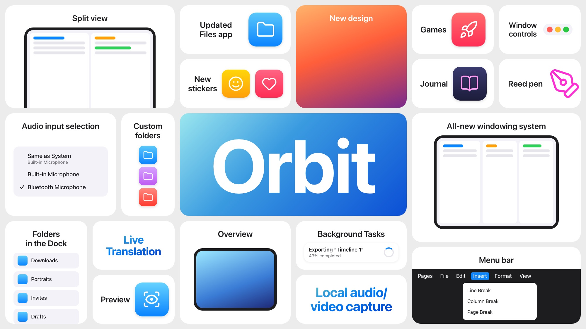

# Bento announcement images

A bento is one image built from rounded tiles on a plain canvas, with no
headline across the top: the tiles are the announcement. Pick one of two formats.

- **Announcement collage** (`canonical`, 2000 x 1620, 12 tiles): paired small
  tiles each carry one number or one icon, big corner tiles carry records or
  visuals, the product floats in the middle without a tile, one tile carries
  the call to action, and one carries the logo. Best for one feature or module.
- **Keynote board** (`keynote`, 2000 x 1125, 19 tiles; or `keynote-product`,
  21 tiles): Apple's WWDC and iPhone event summary slide. Every tile is one
  named feature with its own visual, the centre tile carries the product name
  or the product itself, and the density is the message. Best for a release,
  a week of changes, or many features at once.





Everything runs through one stdlib script (Chrome or Chromium must be installed):

```
B=~/.agents/skills/bento/scripts/bento.py
uv run python $B slots                       # the canonical layout's slots and roles
uv run python $B slots keynote               # the keynote board's 19 slots
uv run python $B slots keynote-product       # the product board's 21 slots
uv run python $B make spec.json --scale 1    # build HTML, check overflow, render a 1x PNG
uv run python $B make spec.json              # final: 2x PNG (4000 x 3240, keynote 4000 x 2250)
uv run python $B build spec.json             # HTML only
uv run python $B render out/page.html        # re-render an edited page
```

`make` writes `<outdir>/<name>.html` (fonts and images inlined, one file) and
`<name>@2x.png`, default outdir `out/` beside the spec. It fails with exit 2 and
names the tiles when any tile's content comes within 8 px of its edge; fix the
copy or sizes instead of passing `--allow-overflow`.

## Workflow

1. **Collect true facts first.** Read the source: constants, config, catalogs,
   changelog, docs. Every number on a tile comes from the code or the user,
   never from memory. Note which values are illustrative (a sample hero's
   level, a rolled stat, a timer) and check rollout state before writing
   anything that reads as live (a feature flag that defaults off, a pending
   deploy). Real strings beat invented ones: item names, flavour text, menu
   labels, command names.
2. **Pick the theme.** If the project has a design system, use its palette and
   fonts: an existing theme (`noise`), or a new `themes/<project>.json` copied
   from `neutral.json`. Otherwise use `neutral`. If the brand forbids rounded
   corners or gaps, ask before deviating, and say so in the report.
3. **Pick the format and cast the slots** (tables below). For the collage,
   decide the hero first: the product, its UI, or the thing the feature
   produces, drawn for real. For the keynote board, list the features first
   (about 17 besides the hero and the accent), rank them, and give the biggest
   slots to the ones with the best visuals, not the most words.
4. **Write the spec** in a scratch folder (`/tmp/bento-<slug>/spec.json`, or
   `~/.t3/artifacts/<slug>/` in T3), with any custom HTML parts beside it.
   Start from `examples/starter.json` (neutral), `examples/spoils/` (custom
   visuals, NOISE), `examples/keynote-starter/` (Apple light board),
   `examples/keynote-product-starter/` (Apple dark product board) or
   `examples/noise-weekly/` (a keynote board in the NOISE brand).
5. **Render at 1x, look, fix, repeat.** Read the PNG. Look for wrapped
   figures, widowed words, crowded or empty tiles, and two tiles saying the
   same thing. The overflow check catches clipping, not taste.
6. **Final at 2x and deliver.** Embed the PNG in the reply with its absolute
   path, ``, so the user sees it and can copy it.
   In T3 you may also show it with `html_render` (an `` page pointing at
   the PNG path). Give the file paths, list illustrative values and caveats.
   Don't commit, publish or post it anywhere unless asked.

## The canonical layout (2000 x 1620)

Margins 60 x 44, gaps 22, radius 32. `slots` prints these.

| Slot | Size | Role | Good content |
|---|---|---|---|
| A | 606x472 | big, top left | a legend, a record, a visual |
| B | 248x242 | small | label over figure: "Starts at / $799" |
| C | 336x242 | small | icon over a two-to-four-word caption |
| D | 606x766 | tall, bottom left | the richest record or visual |
| T1 | 352x244 | small | the headline number and its caption |
| T2 | 250x244 | small | icon over a short caption |
| HERO | 576x994 | floating, no tile | the product or UI itself |
| BL | 334x244 | small | figure and caption |
| BR | 268x244 | small | the logo or wordmark |
| E | 606x396 | big, top right | a photo with overlay text, or a record |
| F | 606x318 | statement | the one call to action, in the accent |
| G | 606x772 | tall, bottom right | a portrait visual or a tall record |

For another canvas, write a layout JSON (`canvas` and named `slots` with
`rect: [x, y, w, h]`) and pass it as `"layout": "my-layout.json"`; or give a
tile a `rect` directly. Keep the gap and margins even. The builder rejects
overlaps and tiles off the canvas.

## The keynote board (2000 x 1125)

Two layouts, both measured from Apple's own summary slides (sources at the end
of this section). `slots <layout>` prints each slot's role.

**`keynote`**, from the iPadOS 26 board (WWDC 2025): five columns (578, 378,
378, 279 and 279 wide), three bands of 351, margins and gaps 18, radius 30.
Small tiles stack in pairs of 166 and 167. The hero is the product name.

| Slot | Size | Good content |
|---|---|---|
| TL | 578x351 | label on top, a UI or product visual bleeding off the bottom |
| T2a, T2b | 378x166 | label left, app icon (or a row of three) right |
| T3 | 378x351 | a photo, or a full visual with the label over its top |
| T4a, T4b, T5a, T5b | 279x166 | label left, app icon or a tiny UI detail right |
| ML | 378x351 | label on top, a UI panel: a menu, a message, a card |
| MS | 182x351 | label on top, two or three icons or chips stacked |
| HERO | 774x351 | the product name in huge type on a flat or photo ground |
| RT | 576x440 | label on top, the richest UI visual |
| BL | 280x351 | label on top, a UI visual bleeding off the bottom |
| B2a, B4b | 280x166, 378x167 | statement: two to four words in big coloured type |
| B2b | 280x167 | label left, app icon right |
| B3 | 378x351 | label on top, a UI screen |
| B4a | 378x166 | a label and one UI row, a progress pill or a notification |
| RB | 576x262 | label on top, a UI strip bleeding off the bottom, or the accent tile |

**`keynote-product`**, from the iPhone 14 Pro board (September 2022): the
product photo fills a 972x532 hero, with a wide tile above it (three screens
bleeding off its bottom) and three below it (a UI detail, a big figure, a
visual). Each side has two columns of 227-wide small tiles, and a wide
statement band runs across them (ProMotion, Ultra Wide). Margins and gaps 20.
Use it when the product itself is the picture.

What makes it read as Apple, and what to copy (from the iPadOS 26, iOS 26
and other WWDC 2025 boards, iPhone 14 Pro and iPhone 16 Pro):

- **One feature per tile, named in two to four words.** The label is the
  feature's name in sentence case ("Window tiling", "Hire a mercenary"), set
  at about 28 to 30 px in a semibold sans, centred, the same size on every
  tile. A tile never carries a list of facts; a second fact gets its own tile.
- **The visual carries the content.** Real UI (a menu, a notification, a
  screen), a real app icon, the product, or a photo. Visuals fill their tile
  and may run off its edge (`bleed`); a cropped screenshot reads as "there's
  more", empty space reads as "nothing here".
- **Five tile shapes, mixed.** Label on top with a visual below; visual with
  the label under it (icons and objects: "Games", "MagSafe"); label left with
  an icon right (small tiles); a full-bleed photo with the label over its top
  or bottom; and the statement, a few words in big coloured type. Use two to
  five statements a board, and don't put two side by side.
- **Statements come in three kinds.** A feature name alone ("Live
  Translation"); a stat, a coloured figure over a one- or two-line caption
  ("1600 nits / Peak HDR brightness", `sub`); and an eyebrow over a big word
  ("New 12MP / Ultra Wide", `eyebrow`). Stats often come in matching pairs.
- **The hero names or shows the product.** Either the product or release name
  in the largest type on the board ("iPadOS", "PRO") over the product's own
  ground, or the product photo filling the tile (`keynote-product`). It
  replaces the logo tile.
- **Devices frame real UI.** Screens sit in a phone, tablet or laptop frame
  (`device`), usually cropped by the tile's bottom edge.
- **Density with calm.** About 19 tiles, uniform tile colour, colour coming
  from the visuals and the statements, even gaps, no borders, no headline.
- **Apple's colours, sampled from the slides.** Light boards use white tiles
  on #ebeceb, near-black labels, and statements in a teal-to-blue gradient
  (#5bbdc5, #0179f3, #003ece). Dark boards use black tiles on #181818, white
  labels, and statements in a purple glow (#a241d4 to #e172fd) or blue stats
  (#71bcdc to #0578c4). `keynote-light` and `keynote-dark` carry these values.
- **Brand rules win.** Apple's gradients, glows and shadows are style, not
  structure. A brand that forbids them (NOISE does) keeps flat fills: flat app
  icons, one-colour brand marks, flat statement colour.

References: the iPadOS 26 and iPhone 16 Pro boards, the iPhone 14 Pro board
([Bring to Front](https://btf.beehiiv.com/p/summary-grids-10)), and every
WWDC 2025 board side by side
([MacStories](https://www.macstories.net/news/wwdc-2025-all-the-small-things-bento-box-version/)).
Look at one again before a big board; the patterns repeat.

## Copy and composition rules

- **One fact per small tile.** A figure of at most about 8 characters, a
  caption of at most about 8 words and 3 lines. Never repeat a fact across tiles.
- **Weight at the corners.** Big dark tiles (A, D, E, G) and the hero carry the
  visuals; the light tiles stay quiet. Light tiles centre their text; record
  and visual tiles align left.
- **One accent tile**, for the one act (a command, "Order now", a price), its
  text naming the act. The builder warns on a second one.
- **The hero floats.** `tone: "none"`, no background: a device frame around
  real UI, the product photo, a board. Fill the slot with an absolutely
  positioned element (`position:absolute;inset:0`).
- **Records read like the product.** For a game item, use the game's own
  item-record format. For an app, use its real screen.
- **No headline, no footer.** The logo tile signs the image.
- **Legibility at chat size.** Nothing below about 24 px on the 2000 px canvas
  except texture (grid letters, tiny tags) and the detail inside a UI visual,
  which only has to look real. Long captions get `text-wrap:balance`.
- **Keynote boards** follow the list in the keynote section instead of the
  corner-weight and floating-hero rules: labels name features, visuals carry
  the facts, the hero names the product, and the one accent tile still holds
  the one act.

## Spec reference

```json
{
  "name": "file-stem",
  "title": "Page title", "alt": "One-sentence description for the image",
  "theme": "neutral | noise | path/to/theme.json | {inline}",
  "layout": "canonical | path/to/layout.json | {inline}",
  "css": "extra.css" ,
  "tiles": [ { "slot": "T1", "type": "stat", ... } ]
}
```

Common tile keys: `slot` or `rect`, `type`, `tone` (`light`, `dark`,
`accent`, `none`), `align` (`center`, `left`), `class` (extra classes for your
CSS), `background` (any CSS background for the tile), `style` (inline CSS).
Text fields accept `**bold**` and `\n`.

| Type | Default tone | Keys |
|---|---|---|
| `stat` | light | `label`, `figure`, `caption`, `figure_size`, `caption_size`, `label_size` |
| `icon` | light | `icon` (a [Lucide](https://lucide.dev/icons) name) or `icon_svg`, `icon_size`, `icon_stroke`, `figure`, `caption` |
| `logo` | light | `text` (set in the display face) or `src` (image), `caption` |
| `list` | dark | `eyebrow`, `title`, `title_size`, `subtitle`, `lines` (strings or `{text, color}`), `line_size`, `note` |
| `image` | none | `src`, `position` (object-position), `scrim` (0 to 1 flat veil), `overlay: {figure, caption, place: center/bottom/top, color}` |
| `html` | light | `html` or `html_file` (path relative to the spec) |
| `feature` | light | `label`, `label_size`, `sub`, `sub_size`, `arrange` (`top`, `bottom`, `left`, `right`, `over` with `place: top/bottom`), one visual: `app`, `apps` (with `apps_direction`, `apps_gap`), `app_size`, `icon` (with `icon_size`, `icon_color`), `src` (with `fit`, `position`), `html` or `html_file`; `device` (`phone`, `tablet`, `laptop`, with `device_width`) to frame the visual as a screen; `bleed` (`true`, `bottom`, `right`, `left`, `edges`), `visual_style` |
| `statement` | light | `text`, `font` (`sans` or `display`), `size` or `max_size`, `color` or `gradient` (list, with `angle`), `glow` (a drop-shadow, such as `0 0 14px rgba(…)`), `eyebrow`, `eyebrow_size`, `sub`, `sub_size`, `char_width`; with no colour set, the theme's `statement` default for the tile's tone applies |

**Feature tiles** are the keynote board's unit: a label and one visual.
`bleed` stretches the visual to the tile edge so its content can run off it;
the overflow check skips everything inside a bleeding visual (and every
`over` visual), so check those crops by eye. Custom visuals start
left-aligned; labels centre. Labels default to 28 px, Apple's size on a 2000
px slide; keep one size across the board.

**App icons** (`app`, `apps`): a glyph on a rounded square, given as an icon
name or `{icon, color or colors, glyph, glyph_scale, stroke}`. Two or more
`colors` make a vertical gradient (Apple style); one is flat (NOISE style).

**Icon names** are Lucide names, or `si:<slug>` for a one-colour brand mark
from [Simple Icons](https://simpleicons.org) (`si:spotify`, `si:threads`),
cached in `~/.cache/bento/simple-icons`. Brand marks are trademarks; use them
only to name the service the feature works with.

Figure sizes default to the largest that fits the tile. Pin them
(`figure_size`) once you like a render.
Icons come from `lucide-static@latest` and are cached in
`~/.cache/bento/lucide` (`--refresh-icons` refetches). Images and fonts are
inlined, so the HTML is one portable file.

**Custom HTML and CSS.** Use `html` tiles for anything bespoke (a game board, a
chart, a device frame). The builder exposes `--canvas --tile --ink --mute
--dark --on-dark --on-dark-mute --accent --on-accent --sans --mono
--display-family --display-weight --display-stretch --display-tracking
--radius --s` (scale, 1 at 2000 px). It owns the classes `.tile .tone-*
.type-* .align-* .fig .cap .lab .ic .eyebrow .title .subtitle .lines .note
.overlay .scrim .fill .appicon .apps .ftext .flab .fsub .fvis .bleed .bleed-*
.arr-* .place-* .fimg .stm .font-* .eyb .device .device-* .screen`, so name your own elements differently
(for example `.itile`). Scope custom rules under the tile's `class`. Use `html_file` parts
for anything longer than a line.

## Themes

`themes/*.json`: `colors` (`canvas`, `tile`, `ink`, `mute`, `dark`, `on_dark`,
`on_dark_mute`, `accent`, `on_accent`), `fonts` (`sans`, `mono`, and `faces`
with `family`, `file`, `weight`, `stretch` to embed), `display` (`weight`,
`stretch`, `tracking`, and `char_width`, the average glyph width in em that
auto-sizing uses), optional `statement` (`char_width`, and per tone `light`
or `dark` a `gradient` or `color` with `angle` and `glow`), `radius`, optional
`css`. Font files resolve beside the
theme, then in `assets/fonts/`; embed only fonts you may redistribute (OFL is
fine).

- **neutral:** the reference look, white canvas and warm grey tiles, system fonts.
- **keynote-light** and **keynote-dark:** Apple's light and dark summary
  boards, colours sampled from the slides, the system font stack (SF Pro on a
  Mac; never embed SF Pro, its licence forbids it), gradient statements, soft
  app-icon shadows on light.
- **noise:** NOISE's Transmission system (approved 2026-10-31, replacing
  Verdant's sage and lime): hull ceramic canvas, bulkhead tiles, hull-blue
  plate tiles for dark visuals, blue-graphite ink, IBM Plex Sans with its
  display cut at 500 and full width, IBM Plex Mono for records (bundled,
  OFL), values from `resources/design/tokens.edn`. Tiles take the 24 px frame
  radius; cards inside a tile use `--card-radius` (14 px) and controls
  `--control-radius` (10 px), and nothing is pill-shaped. Three gels name the
  product a tile belongs to: coolant for the app, flare for the Lounge and
  sodium for news and Static. The theme exposes each as `--coolant`,
  `--coolant-text` (on ceramic) and `--coolant-night` (on plate), and the
  same for flare and sodium. A gel is a flat disc (`<span class="gel-disc">`)
  or an edge strip beside the product's name, never a fill behind running
  text. Statements default to the coolant text tone; give a tile its own
  product's tone with `color`. The one act is filled in ink and carries a gel
  strip on its top edge (set `--gel` in the tile's `style` to change it).
  Goat approved rounded, gapped bentos for NOISE announcements on 2026-10-11;
  every other NOISE export still follows the print family. Rarity colours
  stay on the ARPG ground (see the Spoils example's `spoils.css`).
- **noise-keynote:** the same Transmission values arranged like Apple's light
  board: ceramic tiles on the bulkhead canvas, plate tiles for dark visuals
  and the hero. Flat colour only (no gradients, glows or shadows, no red or
  green outside a game ground), so app icons are flat squircles and brand
  marks are one colour.

## Examples

- `examples/starter.json`: every slot with placeholder copy, neutral theme
  (`examples/starter-preview.jpg`).
- `examples/spoils/`: the NOISE `!arpg` announcement. It shows custom `html`
  parts (paper doll and pack board as the hero, a Vault grid, item records),
  a scoped stylesheet, and tiles whose facts all trace to source constants.
  It was made in Verdant; it renders in the current theme, but its art
  direction predates Transmission.
- `examples/keynote-starter/` and `examples/keynote-product-starter/`: an
  invented product on the two Apple layouts and themes, every tile shape,
  device frames, app icons, stats, an eyebrow statement and a photo tile.
  Copy one to start an Apple-style board for any project.
- `examples/noise-weekly/`: a NOISE weekly review as a keynote board, from the
  week of 2026-10-23. It uses every feature arrangement, app icon rows, brand
  marks, bleeding UI cards (the Longhouse roster, a flight board, an issue
  list, a week chart), statements and the hero wordmark. Its rolls, prices,
  flight, coin and request hex are illustrative; the counts came from GitHub
  and git. It predates Transmission: its spec hard-codes Verdant lime
  (`#dcff4f`), so copy its structure, not its colours.
- `examples/noise-transmission/`: the Transmission launch board (2026-11-01),
  the current NOISE look on the keynote layout: gel-coded statements, hairline
  station drawings, and the Monopoly, Breach, Battleship and Orbit tiles.

## Gotchas

- Chrome runs headless with a throwaway profile; set `BENTO_CHROME` if it
  isn't found. Playwright's Chromium under `~/Library/Caches/ms-playwright`
  also works.
- A page edited by hand can be re-rendered with `render` as long as it keeps
  the `bento:size` meta and the check script.
- Overflow is measured after fonts load. A missing font silently falls back
  and changes widths, so check that a theme's font files exist.
